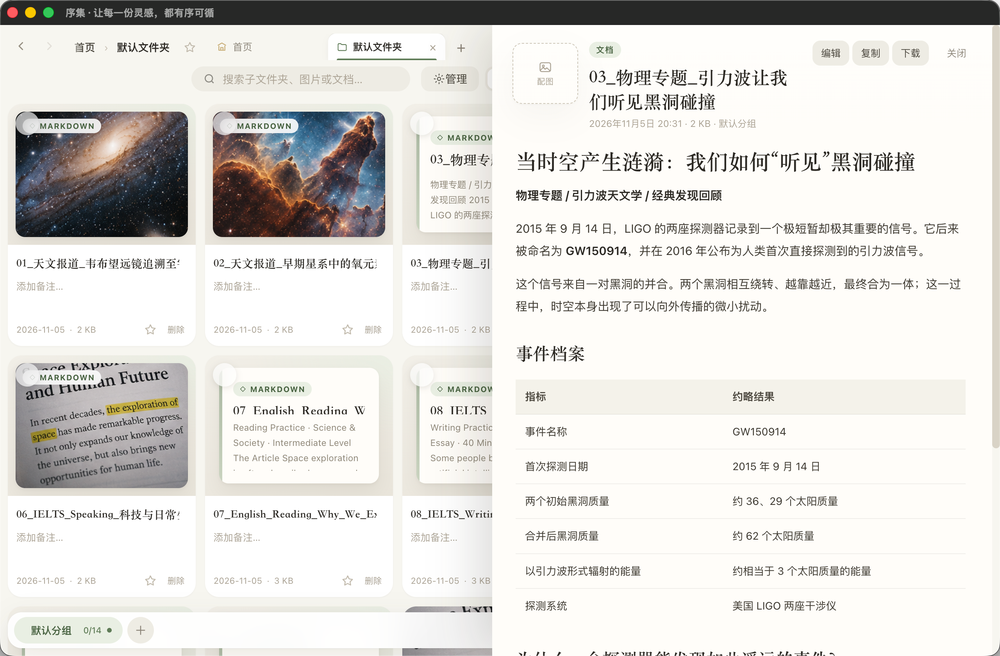

# 序集 XUJI

> 让每一份灵感，都有序可循。

序集是一个离线的图片 + Markdown 文档整理工具：复制粘贴或拖入图片、导入 `.md` 文档、命名、写备注、分组、收藏、标记完成，然后一键分享或备份。Windows 与 macOS 两端源码、图标和构建脚本统一放在这个仓库里。



## 下载

发布页：https://github.com/kkkki04/xuji/releases/tag/v1.0.0

- **Windows**：`XUJI-Windows-x64-v1.0.0.exe`
  - 1,388,544 字节，单文件免安装，Windows 10/11 x64
  - SHA-256 `8B91A790A5C1E65ECE221C6FE817D0EA3CB7358D54491F5B7AA65BCB6C570259`
- **macOS（Apple Silicon）**：`XUJI-macOS-arm64-v1.0.0.dmg` / `.zip`
  - DMG 121,461,328 字节，SHA-256 `25CA4C4F77F20D8CF28E0E16BEF0B348412546EDB62F37996BF4A83685A92FD6`
  - ZIP 120,563,231 字节，SHA-256 `4705C1918E14B72E3BAD1A0C1E4F8A87D94EE3822D62F24EAE6FBB5294445C0F`
  - 未签名版本：首次打开请右键「序集.app」→ 打开，或执行
    `xattr -dr com.apple.quarantine "/Applications/序集.app"`

## 功能

- 图片备注、文件夹层级、分组、收藏、完成状态
- 图片编辑 / 裁剪；大图预览 20%–600% 缩放、拖动
- 导入 Markdown 文档（`.md`），点击文档卡片在右侧滑出阅读栏
- 顶部「图片 / 文档」勾选筛选
- 大 / 小窗口都固定两行头部；小窗口搜索、分享、备份收进图标和「⋯」菜单，排序 / 视图改为下拉
- 记住上次窗口大小与最大化状态
- 流式 `.jsonl` 备份 / 导入；ZIP 导出包含「文档/」目录
- 拖拽导入：图片、`.md` 文档、整个文件夹、微信图片
- 鼠标侧键前进 / 后退；`Ctrl+Z` / `Ctrl+Y`（Mac `⌘Z` / `⇧⌘Z`）撤销重做

## 目录

```
xuji/
├─ windows/                 Windows 版（WebView2）
│  ├─ index.html            页面源码
│  ├─ src/Program.cs        WinForms 宿主
│  ├─ src/build.ps1         编译 序集.exe
│  ├─ src/make-icons.ps1    生成 Windows 图标
│  └─ assets/               Logo 与 icon.ico
├─ macos/                   macOS 版（Electron）
│  ├─ renderer/index.html   页面源码
│  ├─ src/main.js           主进程、窗口大小记忆、菜单
│  ├─ build/icon.icns       App 图标
│  └─ scripts/make-icons.ps1 生成 macOS 图标
├─ docs/screenshots/        界面截图
└─ VERSION.txt             版本与校验值
```

## 数据兼容

品牌更名不影响原有数据：

- Windows 数据目录仍为 `图记数据\`，WebView2 userData 在其下的 `userdata\`
- Windows 虚拟域名仍为 `https://tuji.local`
- macOS userData 仍为 `~/Library/Application Support/图记/`
- macOS 自定义协议仍为 `app://tuji`
- IndexedDB 数据库仍为 `picnote-db`，localStorage 仍为 `picnote-*`
- 备份文件内部标识仍为 `picnote`

新旧版本可以读取同一份数据，不需要迁移。

## 构建

**Windows**

```powershell
powershell -ExecutionPolicy Bypass -File windows\src\build.ps1
```

生成 `序集.exe`（默认输出到仓库根目录）。需要 Windows 自带的 .NET Framework `csc.exe`。

**macOS**

```bash
cd macos
npm install
npm run dist:mac
```

生成 `macos/dist/序集-1.0.0-arm64.dmg` 和 `.zip`。

## 说明

- 两个平台都不会自动同步，各自保存本地数据。
- 导入备份是追加模式，不会覆盖现有内容；同名文件夹会自动加「导入」后缀。
- 仓库只包含源码、文档和图标，不包含任何用户图片、备份或数据库文件。
